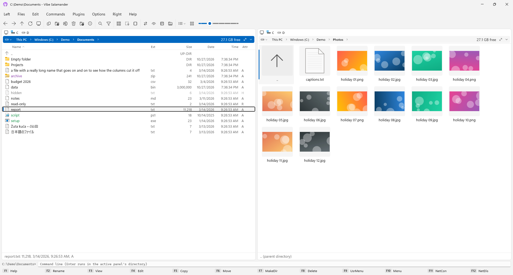
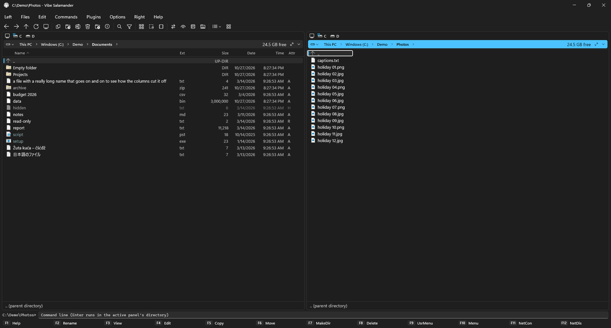
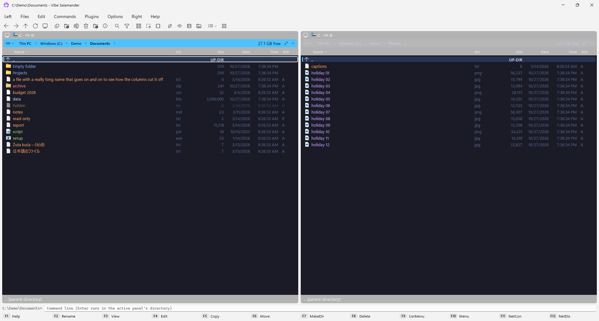
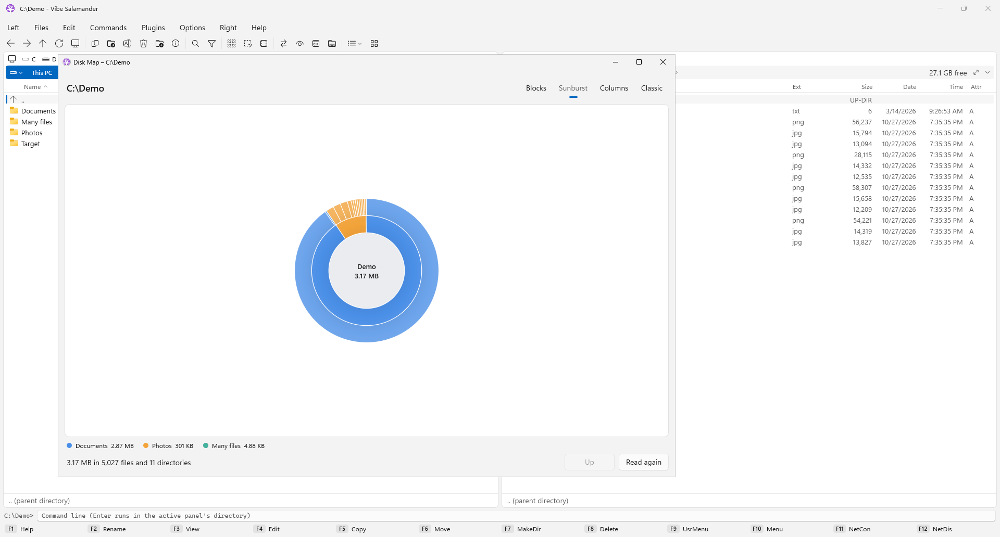

<p align="center">
  
</p>

<h1 align="center">Vibe Salamander</h1>

<p align="center">
  A fast, keyboard-first <b>dual-pane file manager</b> for Windows 10 and 11.<br>
  A modern spiritual successor to <a href="https://github.com/OpenSalamander/salamander">Altap / Open Salamander</a>, built with C# and WinUI 3.
</p>

<p align="center">
  <a href="https://github.com/BrainCluster/vibe-salamander/releases/latest"><b>Download</b></a> ·
  <a href="https://github.com/BrainCluster/vibe-salamander/wiki/Getting-Started">Getting started</a> ·
  <a href="https://github.com/BrainCluster/vibe-salamander/wiki">Wiki</a> ·
  <a href="https://github.com/BrainCluster/vibe-salamander/wiki/Writing-Plugins">Write a plugin</a>
</p>

<p align="center">
  
</p>

Vibe Salamander keeps what made Salamander great (two panels, the classic keyboard shortcuts, the menus, speed
and precision) and gives it a native Windows 11 look, fewer dialogs and a transfer panel that never blocks you.

> Vibe Salamander is to Altap Salamander what [Files](https://github.com/files-community/files) is to Windows File Explorer.

<p align="center">
  
</p>

## Install

**Portable zip:** download `VibeSalamander-<version>-win-x64.zip` (or `win-arm64` for ARM PCs) from the
[latest release](https://github.com/BrainCluster/vibe-salamander/releases/latest), unzip it anywhere and run
`VibeSalamander.exe`. Nothing is installed into Windows; settings are kept in `%AppData%\VibeSalamander`.

**Scoop:**

```powershell
scoop bucket add vibe-salamander https://github.com/BrainCluster/vibe-salamander
scoop install vibe-salamander
```

**winget:** coming soon (`winget install BrainCluster.VibeSalamander`).

> **"Windows protected your PC"?** The program isn't code-signed yet, so SmartScreen is careful with it: click
> **More info → Run anyway**. Every release is built from this source by a public
> [GitHub Actions workflow](https://github.com/BrainCluster/vibe-salamander/actions/workflows/release.yml).

More in the wiki: [Installation](https://github.com/BrainCluster/vibe-salamander/wiki/Installation) (the 7-Zip
plugin, updating, uninstalling).

## Features

**Panels.** Two panels with Salamander's keys: Tab, quick search by typing, Insert / Space to mark, Num + / − / *
to select. Five views (Brief, Detailed, Icons, Thumbnails, Tiles), and a choice of **Classic** views (one per panel,
like Salamander) or **Modern** ones (like File Explorer: thumbnails for photo folders, a remembered view for each
folder). A Windows 11 address bar, drive bars, hot paths, history, filters, live USB drives.

**Files.** Copy, move, delete, rename in place, attributes, case, compression and encryption. Copies run in the
**transfer panel**, queued or in parallel, with pause, resume and cancel. One question when a file exists, and
notifications instead of dialogs.

**Archives and more** (plugins). ZIP, TAR, 7z, RAR and more: pack, unpack, browse and edit archives like folders,
test them, make self-extracting ones. **FTP, FTPS and SFTP** servers in the panels. **Checksums** (CRC32 to
SHA-512). **Disk Map**: what takes the space, four ways. Disk images (.iso, .img, .vhd, .vhdx) mount as drives.

**Tools.** Find files (Alt+F7), compare directories, directory sizes, a user menu with your own commands, a command
line, network drives.

**Make it yours.** Light and dark themes, color schemes from Vibe and Explorer to Tokyo Night, Dracula, Nord and
Norton Commander, compact or comfortable density, any key for any command, a custom toolbar, 12 languages.

The full list, with pictures: [Features](https://github.com/BrainCluster/vibe-salamander/wiki/Features) ·
[Keyboard shortcuts](https://github.com/BrainCluster/vibe-salamander/wiki/Keyboard-Shortcuts) ·
[Plugins](https://github.com/BrainCluster/vibe-salamander/wiki/Plugins)

| | |
|---|---|
|  |  |
|  |  |

## Plugins

Plugins add archive formats, file systems (like FTP) and commands, and open their own windows through a small
API, without touching the UI framework. [Writing plugins](https://github.com/BrainCluster/vibe-salamander/wiki/Writing-Plugins)
walks through [`samples/HelloPlugin`](samples/HelloPlugin), a complete plugin in one file.

## About this project

Vibe Salamander's code was written by **Claude** (Anthropic's AI model), with **BrainCluster** guiding, testing and
deciding. About 250 automated tests check it, including UI tests that drive the real app on every push (their
screenshots are on the [`ui-screenshots`](https://github.com/BrainCluster/vibe-salamander/tree/ui-screenshots)
branch). It is still young (version 0.x): keep backups of anything important, as with any file manager.

**Found a bug?** Help → Error Log opens the log of what went wrong.
[Open a bug report](https://github.com/BrainCluster/vibe-salamander/issues/new/choose) and attach it.

## Build

Windows 10 (2004) or later, **Visual Studio 2026** with the *WinUI application development* and *.NET desktop
development* workloads, .NET 10 SDK. Open `VibeSalamander.sln`, pick **Debug | x64** and the `VibeSalamander.App`
project, press **F5**. `build\publish.ps1` makes the same folder as a release.

[docs/ARCHITECTURE.md](docs/ARCHITECTURE.md) explains the structure;
[docs/ROADMAP.md](docs/ROADMAP.md) has the plans and the Salamander feature checklist.
[Open Salamander's source](https://github.com/OpenSalamander/salamander) is the behavioral reference.

## License and credits

Copyright © 2026 Vibe Salamander Authors: written by **Claude** (Anthropic's AI model), with **BrainCluster** as
its guide (see [AUTHORS](AUTHORS)).

Vibe Salamander is free software, licensed under the **GNU General Public License v3.0 or later**
([LICENSE](LICENSE)). It is a spiritual successor to Open Salamander, and its application icon is based on the
Open Salamander icon (GPL-2.0-or-later); see [CREDITS.md](CREDITS.md) for the full credits to the Servant / Altap /
Open Salamander authors and the third-party components.
