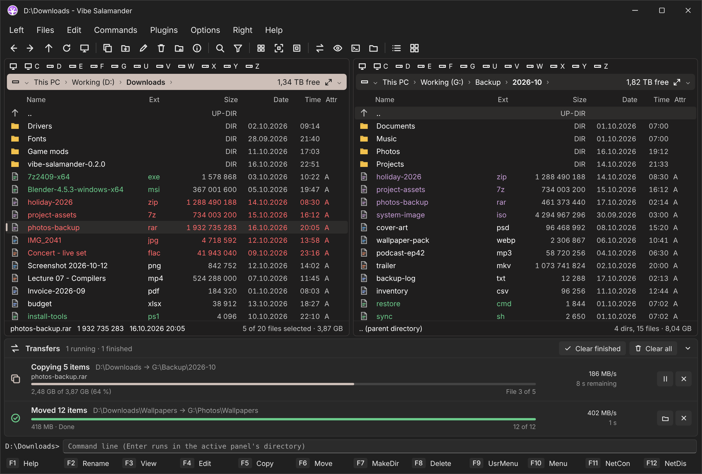

  

<h1 align="center">Vibe Salamander</h1>

  A fast, keyboard-first <b>dual-pane file manager</b> for Windows. 
  A modern spiritual successor to <a href="https://github.com/OpenSalamander/salamander">Altap / Open Salamander</a>, built with C# and WinUI 3.

  

Vibe Salamander keeps what made Salamander great (two panels, the classic keyboard
shortcuts, the menus, speed and precision) and gives it a modern Fluent look in the spirit of the
[Files](https://github.com/files-community/files) app, with fewer dialogs and more flexibility.

> Vibe Salamander is to Altap Salamander what Files is to Windows File Explorer.

## Download

Get the latest zip from **[Releases](https://github.com/BrainCluster/vibe-salamander/releases/latest)**
(`win-x64` for most PCs, `win-arm64` for ARM PCs), unzip it anywhere and run `VibeSalamander.exe`
in the main folder (the program and its libraries are in `lib`). No installation needed.
Windows 10 (2004) or later.

To build the same folder yourself: `build\publish.ps1` (or `build\publish.ps1 -Runtime win-arm64`),
the result is in `publish\VibeSalamander`.

## Features

**Panels**
- Two panels with Salamander's keyboard model: Tab to switch, quick search by typing, Insert / Space to mark, Num + / − / * selections
- Five views: Brief, Detailed, Icons, Thumbnails, Tiles (Alt+1…5); choose and resize columns; sort by name, extension, date, size or attributes
- Windows 11 style address bar with a drive menu, clickable path segments and subfolder chevrons; drive bars; This PC with fullness bars
- Live drives: plug in a USB drive or memory card and it opens in the focused panel; pull it out and the panel goes back to This PC
- Hot paths 1–9, back / forward history, filter (Ctrl+F12), hidden and system files toggle, maximize or swap panels
- Mouse rectangle selection, drag & drop between panels and to or from Explorer, auto-refresh that keeps the cursor and marks

**Files**
- Copy, move, delete, rename in place (F2), change attributes and case, NTFS compression and encryption, properties and security
- A background transfer panel: queued and parallel transfers with pause, resume and cancel, so copying never blocks you
- Files open in their default Windows apps (no internal viewer); Open with, per-mask viewers and editors
- A Vibe context menu with the most useful commands, plus the full Windows context menu one click away
- Fewer dialogs: new folders and files are created and renamed in place, errors appear as notifications that close themselves

**Archives and disk images**
- Archive plugin: pack ZIP (optionally AES-256 encrypted) / TAR / TAR.GZ (Alt+F5), unpack ZIP, 7z, RAR, TAR, gz, bz2, xz and lz (Alt+F6), with passwords
- FTP / FTPS / SFTP plugin (Commands → Connect to FTP / SFTP Server): saved servers, password or SSH key, the server in the panel like a folder, copies both ways in the transfer panel
- Browse archives like folders and copy single files out of them; ZIP and TAR archives can be edited in place: copy or drop files in, delete them (F8), move them out (F6)
- Mount .iso, .img, .vhd and .vhdx images: the mounted drive opens in the other panel, unmount from the menu

**Tools**
- Find files (Alt+F7), compare directories, directory sizes, drive information, file lists
- Command line and command shell, user menu with variables, network drives and shares
- Checksum plugin: CRC32 (SFV), MD5, SHA-1, SHA-256 and SHA-512 of files and folders, saved to checksum files and verified again (Ctrl+Shift+V)
- Plugins with their own menus (Plugins Manager)

**Make it yours**
- A full Configuration window with the Open Salamander pages: confirmations, panels, views, colors, drives, keyboard, toolbar, hot paths, user menu and more
- Color schemes: Vibe, Explorer, terminal-inspired Yazi, Superfile, Tokyo Night, Gruvbox, Dracula, Nord and Phosphor, Norton Commander, DOS Navigator, or your own; highlighting by file mask
- Light / dark / system theme, Compact or Comfortable density, panel font and size
- Every shortcut can be changed; the toolbar can be customized; settings can be exported and imported
- 12 languages: English, Hrvatski, Čeština, Deutsch, Español, Français, Italiano, Nederlands, Polski, Português (Brasil), Русский, Українська

## Build and run

Requirements: Windows 10 1904x or later, **Visual Studio 2026** with the *WinUI application
development* (Windows App SDK) and *.NET desktop development* workloads, .NET 10 SDK.

1. Open `VibeSalamander.sln`.
2. Select **Debug | x64** (or ARM64) and the `VibeSalamander.App` startup project.
3. Press **F5**. The app runs unpackaged (no MSIX install), the Windows App SDK is bundled.

Settings are stored in `%AppData%\VibeSalamander\settings.json`.

## Keyboard (Salamander defaults)

| Keys | Action | Keys | Action |
|---|---|---|---|
| Tab | Switch panel | Enter | Open |
| Backspace / Ctrl+PgUp | Parent directory (drive root → This PC) | Shift+Backspace | Root |
| Alt+F1 / Alt+F2 | Change drive left / right | Alt+Left / Alt+Right | Back / Forward |
| F2 | Rename | F3 / F4 | Open / Edit (default apps) |
| F5 / F6 | Copy / Move | F7 | Create directory |
| F8, Del / Shift+Del | Delete (Recycle Bin / permanent) | Alt+Enter | Properties |
| Insert / Space | Mark item | Ctrl+A / Ctrl+D / Num * | Select all / none / invert |
| Ctrl+F3…F6 | Sort by name / ext / date / size | Ctrl+R, Ctrl+F9 | Refresh |
| Ctrl+U | Swap panels | Ctrl+F11 | Maximize panel |
| Ctrl+H | Hidden files | Ctrl+. | Path from other panel |
| Shift+F7 | Change directory | Shift+F3 | Open in Explorer |
| Num / | Command shell | typing | Quick search |
| Alt+F5 / Alt+F6 | Pack / Unpack | Alt+F7 | Find files |
| Ctrl+1…9 / Ctrl+Shift+1…9 | Go to / set hot path | Ctrl+F12 | Filter |

## Docs

* [docs/ARCHITECTURE.md](docs/ARCHITECTURE.md) – structure, design decisions, addon model
* [docs/ROADMAP.md](docs/ROADMAP.md) – phases and the Salamander feature-parity checklist

[Open Salamander's source](https://github.com/OpenSalamander/salamander) is the behavioral reference.

## License and credits

Copyright © 2026 Vibe Salamander Authors: written by **Claude** (Anthropic's AI model), with
**BrainCluster** as its guide (see [AUTHORS](AUTHORS)).

Vibe Salamander is free software, licensed under the **GNU General Public License v3.0 or later**
([LICENSE](LICENSE)). It is a spiritual successor to Open Salamander, and its application icon is
based on the Open Salamander icon (GPL-2.0-or-later); see [CREDITS.md](CREDITS.md) for the full
credits to the Servant / Altap / Open Salamander authors and the third-party components.
