# Features

## Panels

- Two panels with Salamander's keyboard model: Tab to switch, quick search by typing, Insert / Space to mark,
  Num + / − / * to select by mask.
- **Five views**: Brief, Detailed, Icons, Thumbnails and Tiles (Alt+1…5). In Detailed view the columns can be
  chosen and resized; columns that don't fit a narrow panel step aside so names stay readable.
- **Classic or Modern folder views** (Configuration → Views): one view per panel everywhere, or File Explorer's
  way: tiles for This PC, thumbnails for folders of pictures and videos, and a remembered view for each folder.
- A Windows 11 style address bar with a drive menu, clickable path segments and subfolder chevrons; drive bars;
  This PC with fullness bars.
- **Live drives**: plug in a USB drive or a memory card and it opens in the active panel; pull it out and the
  panel goes back to This PC.
- Hot paths (Ctrl+1…9), back and forward history, a filter (Ctrl+F12), hidden and system files on or off, maximize
  or swap the panels.
- Rectangle selection with the mouse, drag and drop between the panels and to or from Explorer, automatic refresh
  that keeps the cursor and the marks.
- **Quick view** (Ctrl+Q): the other panel shows the item under the cursor — a picture, the start of a text, what's
  in a folder — and follows the cursor.
- **All files of the subfolders** (Ctrl+B, Total Commander's branch view): every file below the folder in one list,
  to copy, delete, rename or compare them together; Ctrl+B again goes back.
- **Hot path list** (Shift+F9; Ctrl+D in Total Commander's shortcuts, or the star button at the end of the address bar)
  as a menu, with "add this folder".
- **Opened files** (Alt+F11, or the document button at the end of the address bar): the files opened lately, newest
  first; choosing one goes to it and opens it again. How many are kept: Configuration → History (10 by default).
- **List menus** (drives, hot paths, opened files, working directories, histories, the user menu) are 50 characters
  wide and 10 rows high, scrolling beyond; a longer path slides sideways under the mouse or the keyboard, and its
  tooltip shows all of it. A letter jumps to the next row starting with it (C for the C: drive).

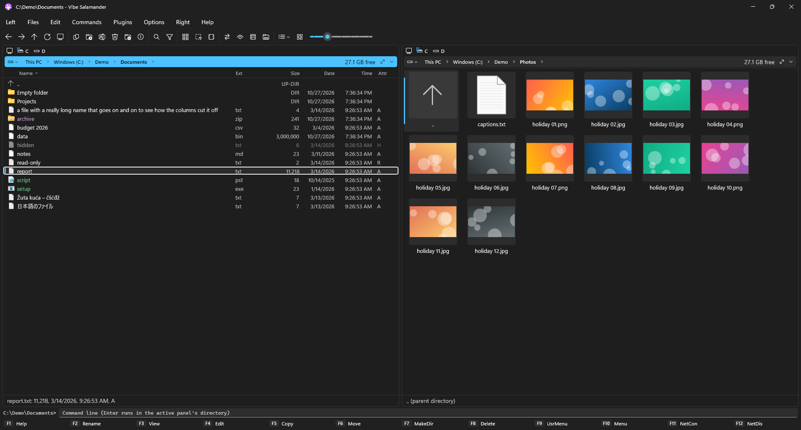

## File operations

- Copy, move, delete, rename in place (F2), change attributes and case, NTFS compression and encryption,
  properties and security.
- **Shortcuts**: *Copy as shortcut* (Ctrl+Shift+L) puts shortcuts to the items on the clipboard, so Paste makes them
  anywhere, also in Explorer; *Paste shortcut* (Ctrl+S) makes shortcuts to the copied files here. Both are in the
  right-click menu when they apply, and the Windows menu of a folder's empty area has Explorer's Paste shortcut.
- **Duplicate** (Alt+Shift+D; Shift+F5 in Total Commander's shortcuts): a copy next to the original, "name (2).ext",
  named in place.
- **Multi-rename** (Shift+F2; Ctrl+M in Total Commander's shortcuts): many names at once from a mask (`[N]` name,
  `[N1-3]` part of it, `[E]` extension, `[C]` counter, `[P]` folder, `[YMD]` / `[hms]` date and time), search and
  replace (text or regular expression, `$1`), and the case. Every new name is shown before anything is renamed, with
  what's wrong with it; names can be swapped or shifted ("1 → 2, 2 → 3").
- **The transfer panel**: copies, moves and deletes run in the background, several at once or queued, each with
  pause, resume and cancel. You keep working while they run.
- **One transfer per disk** (on by default): two copies on the same disk wait for each other instead of slowing each
  other down, while copies between different disks run side by side. Waiting transfers can be moved up, down or to
  the front of the queue.
- **Checks before copying**: not enough free space on the target, files over 4 GB for a FAT32 drive, or a
  write-protected drive are said before anything is copied, not halfway through.
- **Verify copies** (Configuration → Transfers): each copied file is read again and compared with the original.
- **When done**: close the app, lock, sleep, hibernate or shut down the computer when the last transfer finishes,
  after a 60-second countdown you can cancel. The taskbar button shows the overall progress, as Explorer's does.
- A file that's in use says **which program** holds it ("in use by Word"), not only "used by another process".
- **Speed limits**: for each transfer (the gauge button in its row) and for all of them together (in the panel's
  header): 256 KB/s to 200 MB/s or any value you type, changed while the copy runs. **Graphs** (in the header) show
  each transfer's speed over the last half minute, with its limit as a dashed line.
- One question when a file exists, with both files side by side (size, date, and which is newer or larger), a
  *Compare files* button, and overwrite, skip, keep both, older only, each *for all*; and errors as
  notifications that close themselves rather than dialogs you have to click away.
- Careful with links: folder links and junctions are copied as links, never followed into loops, and a move
  never deletes what a link points to.
- F3 views and F4 edits in the built-in viewer and editor (below); Open with (Alt+F3), and per-mask viewers and
  editors of your own.
- Right-click: a short *Vibe* menu with the most useful commands, and the full Windows context menu one click away.
- New folders and files are created and named in place.

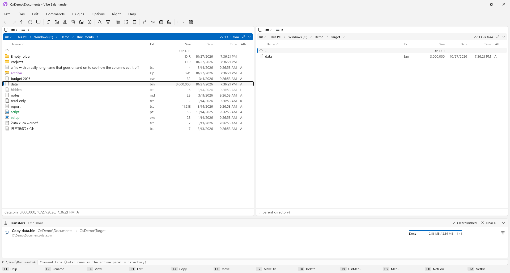

## View and edit

**The viewer (F3)** opens anything, whatever its size:

- **Text and hex** for files of any size: a multi-gigabyte log opens at once and is indexed while you read. Encodings
  (UTF-8/16, ANSI, OEM and more) are detected and can be switched; find text, whole words, regular expressions or hex
  bytes (Ctrl+F, F3 / Shift+F3); go to a line or an offset (Ctrl+G); wrap (W) and line numbers.
- **JSON, XML and YAML as a tree**, with a problem shown at its line when the file is broken.
- **Markdown, Jupyter notebooks and web pages rendered**: tables, task lists, code, pictures next to the file and
  notebook outputs. Nothing is loaded from the internet and no script runs unless you allow it.
- **Pictures**: JPEG, PNG, GIF, WebP, HEIC, AVIF, JPEG XL, SVG and camera RAW (with Windows' free extensions), zoom (also with the mouse wheel) and drag,
  up to 6400 %, fit (0), fit the width (W), rotate (R), mirror (M; Shift+M turns it upside down), full screen (F11),
  the next and previous pictures decoded ahead, and details: size, camera, lens, exposure, date taken, rating,
  keywords, author, copyright, color profile, location with altitude, and **Show on map**.
- **PDFs**, page by page, and **audio and video** with their details.
- Ctrl+PgUp / Ctrl+PgDn (or ← / → for pictures) go to the previous or next file of the folder; Ctrl+1…7 switch between
  the views a file has; F4 edits it.

| 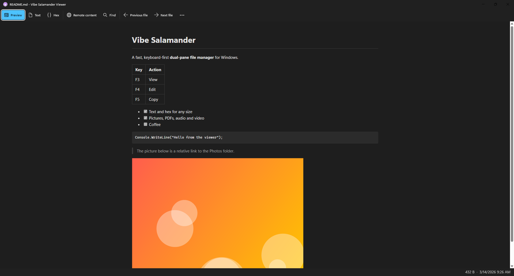 | 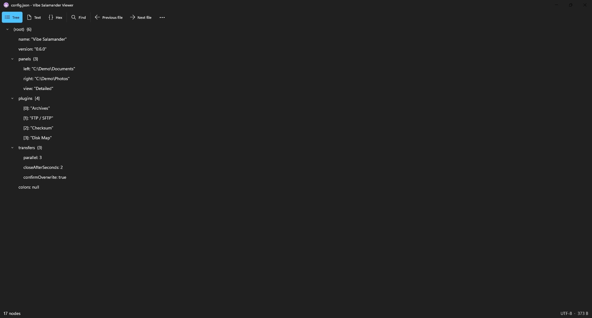 |
|---|---|
| 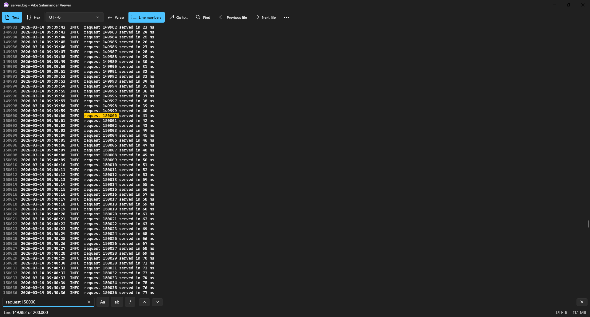 | 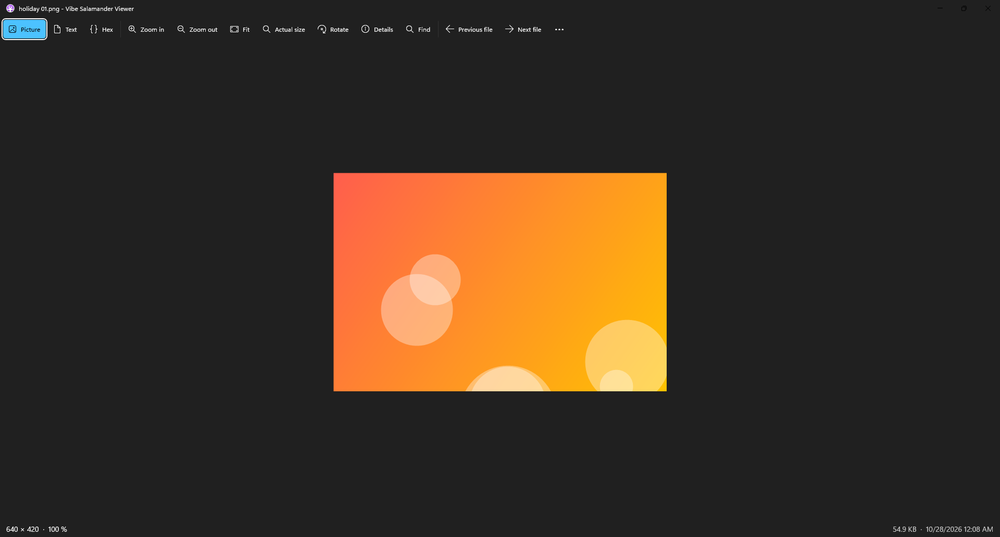 |

**The editor (F4)** is the editor of Visual Studio Code (Monaco):

- Syntax colors for more than 70 languages, folding, multiple cursors, the minimap and the command palette (F1).
- **JSON, XML and YAML are checked while you type**: problems are underlined and the first one is in the status line;
  Format (Shift+Alt+F) tidies JSON and XML, **Minify** puts them on one line, **Sort keys** orders a JSON's keys;
  Ctrl+/ comments a line out.
- **A live preview** of Markdown, HTML and SVG beside the text.
- Find and replace (Ctrl+F, Ctrl+H) with regular expressions; go to line (Ctrl+G).
- The encoding and line endings are kept, or chosen when saving; characters the encoding can't hold are pointed out.
- **Safe saving**: the file is written next to the original and swapped in only when complete, with an optional
  backup (.bak). Changes made by another program are noticed, and closing never loses unsaved work silently.
- Files in archives and on FTP / SFTP servers are edited too: saving sends them back.

| 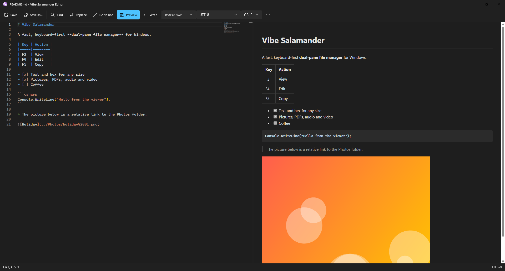 | 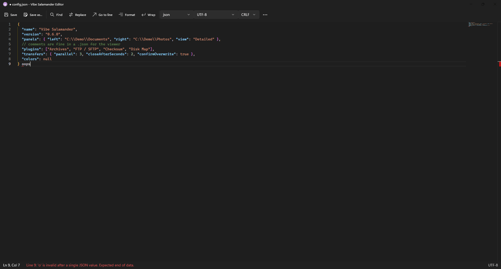 |
|---|---|

## Find, compare and measure

- **Find files** (Alt+F7) in one or several folders at once:
  - names by masks (`*.txt;*.doc|*.bak`), size, date (today, the last week, between two days), attributes, depth and
    folders to skip (`node_modules;.git`)
  - **text rows**: each one "contains" or "doesn't contain", as text, a regular expression or hex bytes, all of them
    or any; every file is read in its own encoding (UTF-8, UTF-16, ANSI), binary files as bytes
  - **inside ZIP files** too
  - the results show **the matching line**, with its number and the match highlighted; the files are read by several
    workers at once
  - **Show in Panel** lists the results in a panel, where you copy, move, delete, view and edit them
  - **saved searches**, and the last search comes back when Find opens
- **Find duplicates** (Alt+Shift+F7) by content, name or size: same size first, then the files' first and last
  16 KB, and only then the whole files, so most files are read only a little. Hard links count once. The groups that
  waste the most come first; one click selects all but the newest (or oldest, or first) of each group, then delete them
  to the Recycle Bin or list them in a panel.
- **Compare directories** (Ctrl+F10) by date, size, attributes or content, also inside subfolders: the differences
  are marked in both panels, and a list shows each one (only left, only right, newer, different), to filter and
  **synchronize**: left → right, right → left, or both ways (the newer wins), with an optional mirror that deletes
  extras (to the Recycle Bin). The copies run in the transfer panel.
- **Compare files** (Ctrl+Shift+C): two marked files, or the file under the cursor and the one of the same name in
  the other panel, side by side or inline, with the differences highlighted. F7 / Shift+F7 go to the next and previous
  difference, Alt+→ / Alt+← copy a difference to the other side, and both sides can be edited and saved. Binary files
  are compared byte by byte; **Only the differences** folds the same lines away. Also from the compare-directories
  list (double-click a file that's on both sides).
- Directory sizes (Ctrl+Shift+F10), occupied space (Alt+F10), drive information (Ctrl+F1), file lists (Ctrl+M).
- **Disk Map** (plugin): what takes the space, as blocks, a sunburst, columns or Salamander's classic treemap.

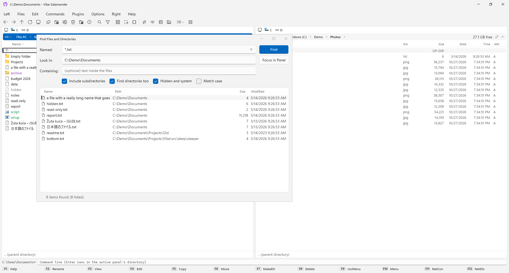

## Commands

- **User menu** (F9): your own commands, with variables such as `$(FullName)`, `$(Name)`, `$(SelectedFullNames)` and `$(OtherPath)`,
  and an optional user menu bar.
- A command line under the panels: Ctrl+Enter puts the name under the cursor into it, Ctrl+Shift+Enter its full
  path (Ctrl+P the folder, in Total Commander's shortcuts), Alt+F8 shows its history. A command shell (Num /),
  network drives and shares.
- **Starting it**: `VibeSalamander.exe -L C:\Work -R D:\ -P 2` opens folders in the left and right panel and makes
  one active (`-A` the active one; a folder alone goes there). With *Allow only one instance*, a second start hands
  its folders to the running window.
- **An installer or a portable zip**: the zip keeps the settings, plugins and logs in a `Data` folder beside the
  program (its `portable.flag` does that), nothing in your profile. **Help → Check for Updates** (and once a day by
  itself) updates either: the new installer runs silently, or the portable files are replaced with `Data` kept; then
  Vibe Salamander starts again. See [Installation](Installation).
- **Mount disk images**: .iso, .img, .vhd and .vhdx open as drives in the other panel.

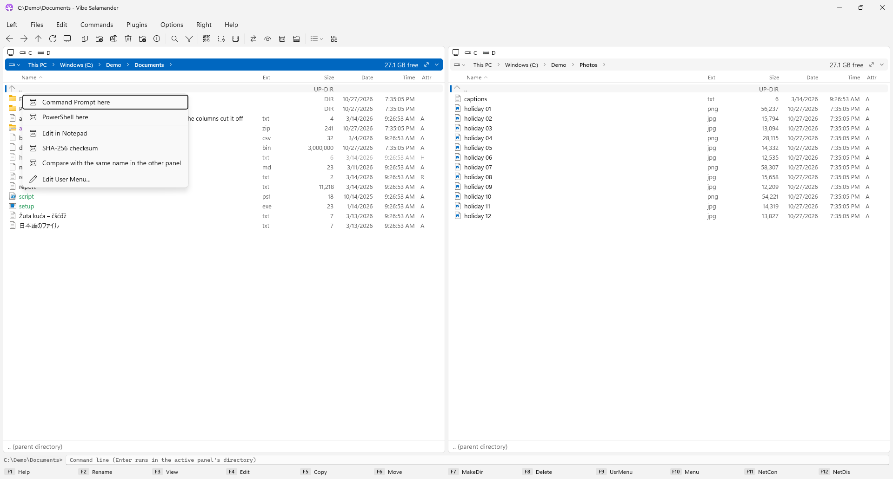

## The menus

| | |
|---|---|
| 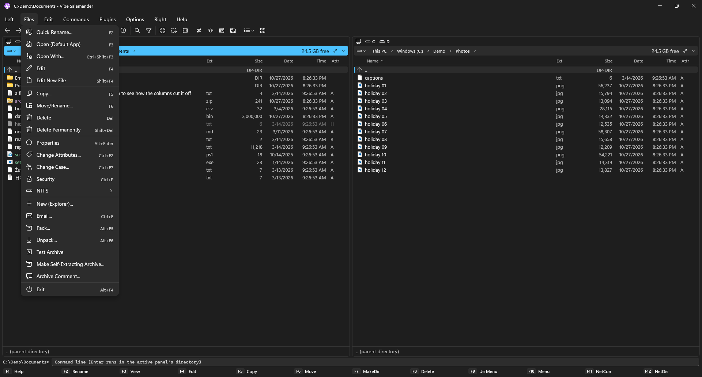 | 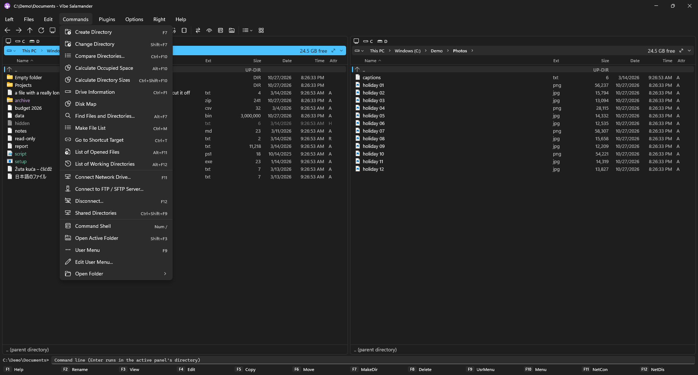 |
| 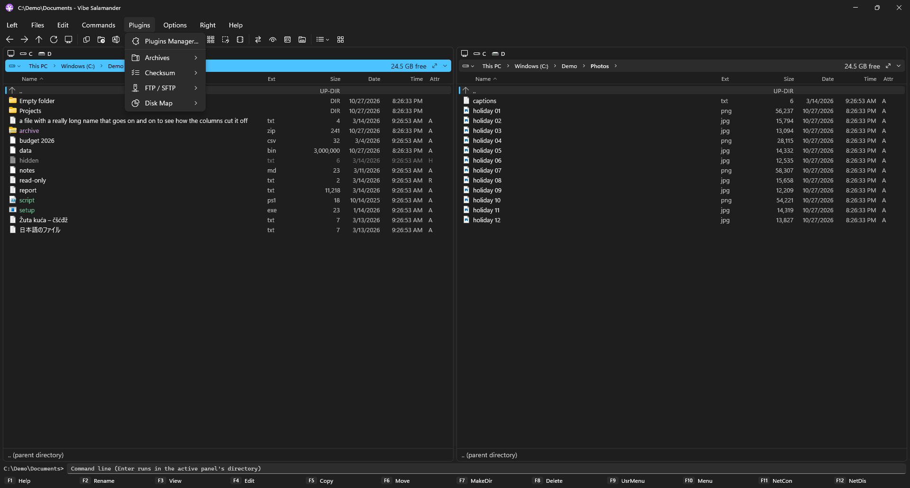 | 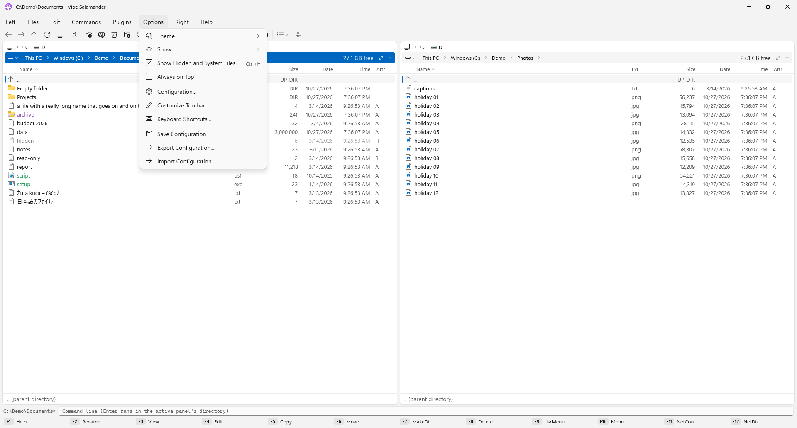 |

## Looks

- Light, dark or the system's theme; Compact or Comfortable density; the panel font and its size.
- **Color schemes**: Vibe, Explorer, Altap Salamander classic, the terminal-inspired Yazi, Superfile, Tokyo Night,
  Gruvbox, Dracula, Nord, Solarized and GitHub (dark and light) and Phosphor, the retro Norton Commander and DOS
  Navigator, or your own — also **imported from a Visual Studio Code theme**. Files can be colored by mask.
- Dates as Windows shows them or as 2026-10-28, times in 24 or 12 hours; sizes in bytes, kilobytes or short.

## Configuration

Options → Configuration has Open Salamander's pages, plus a search box: confirmations, panels, views, colors,
drives, the keyboard (every command can get any key), the toolbar, hot paths, the user menu, the transfer panel,
plugins, and backup (export and import of all settings). The keyboard page tells **which command a key has** (press
it) and makes a **cheat sheet** of all shortcuts to print. **Help → First Steps** chooses the shortcuts (Salamander
or Total Commander), the theme, the folder views, the colors and the language on one page.

| | |
|---|---|
| 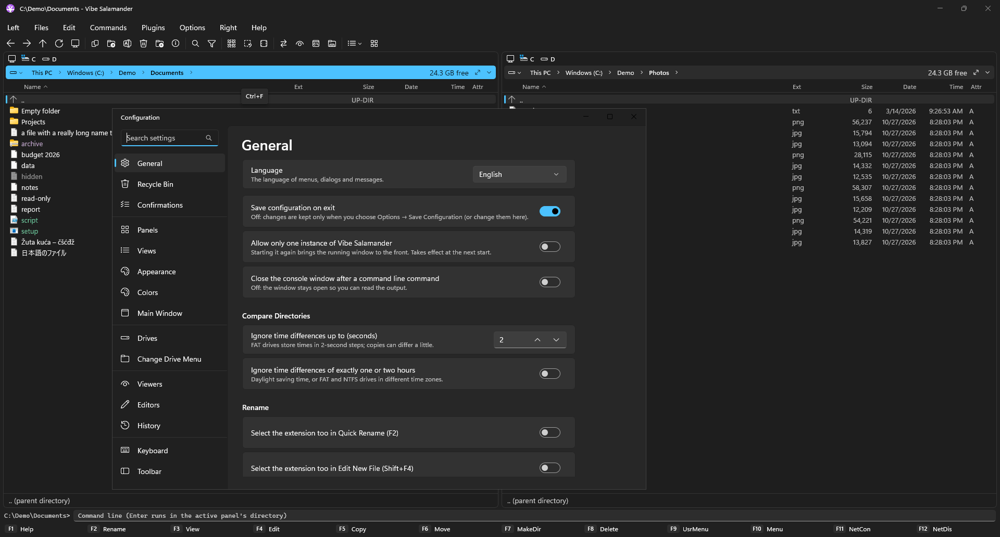 | 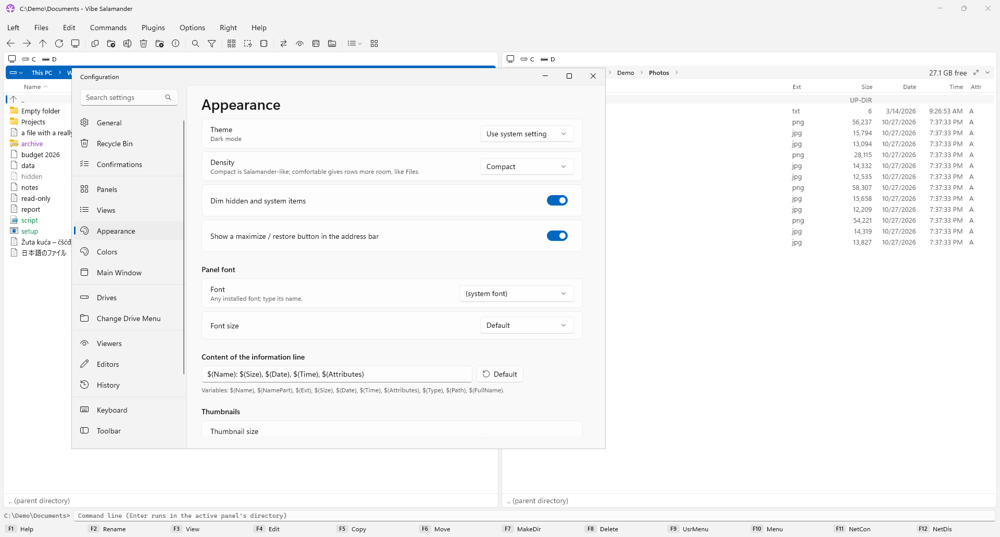 |
| 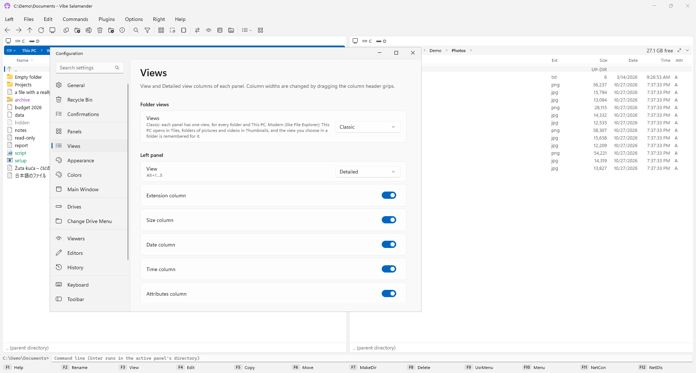 | 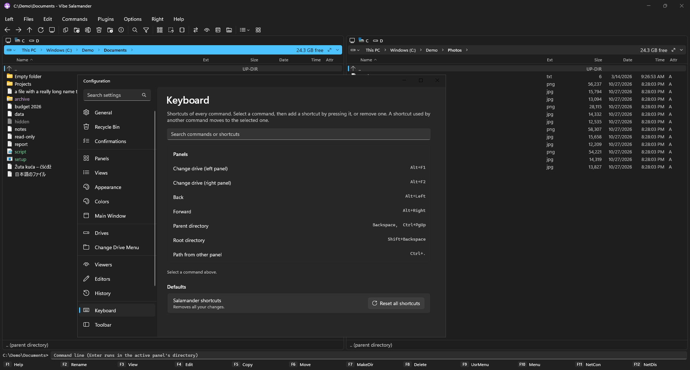 |

## Languages

English, Hrvatski, Čeština, Deutsch, Español, Français, Italiano, Nederlands, Polski, Português (Brasil),
Русский and Українська (Options → Configuration → General → Language).

## When something goes wrong

Errors are written to an error log (Help → Error Log). If Vibe Salamander closed because of an error, it tells you
the next time it starts; if the settings file was damaged, the broken copy is kept and the rest of your settings
are still used. See [Troubleshooting](Troubleshooting).
