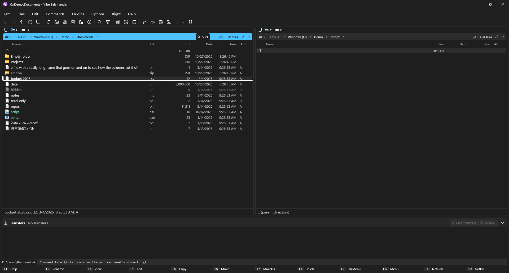

# Getting started

Ten minutes to the essentials. If you have used Altap Salamander, Total Commander or Norton Commander, most of
this will feel familiar: the keys are Salamander's.

## The window

- **Two panels**, side by side. One of them is *active* (its address bar is highlighted): keys and commands work
  on it. **Tab** switches to the other one. Most commands use the other panel as the target: F5 copies the files
  of the active panel into the folder the other panel shows.
- Above each panel: the **address bar** (click a segment to go there, the chevrons list subfolders, the drive
  button lists drives) and a **drive bar**.
- Below: the **info line** (the focused file, or how many files are marked and their size), the **command line**
  (type a command and press Enter to run it in the active folder) and the **F-key bar** with the most used commands.
- On the right, while files are being copied: the **transfer panel**.

## Moving around

| Do this | With |
|---|---|
| Open a folder or a file (in its Windows app) | Enter, or double-click |
| Go up one folder | Backspace (at a drive's root it goes to This PC) |
| Back / forward | Alt+Left / Alt+Right |
| Change drive | Alt+F1 (left panel), Alt+F2 (right panel) |
| Jump to a file | just **start typing** its name (quick search); Esc ends it |
| Type a path | Shift+F7, or click into the address bar |
| Same folder as the other panel | Ctrl+. |
| Favorite folders | Ctrl+Shift+1…9 saves the folder as a hot path, Ctrl+1…9 goes back to it |

## Marking files

Commands work on the **marked** files, or on the focused file when nothing is marked.

- **Insert** or **Space** marks the focused file and moves on.
- **Num +** marks by mask (`*.jpg`), **Num −** unmarks, **Num \*** inverts, **Ctrl+A** / **Ctrl+D** all / none.
- With the mouse: click, Ctrl+click, Shift+click, or drag a rectangle from an empty spot.

## Copying, moving, deleting

| | |
|---|---|
| **F5** | Copy to the other panel's folder (the dialog lets you change the target or the name) |
| **F6** | Move or rename |
| **F7** | New folder (it's created and named in place: just type) |
| **F8** / Del | To the Recycle Bin; **Shift+Del** deletes permanently |
| **F2** | Rename in place |

Copies and moves run in the **transfer panel**, so you can keep working while they run. Each transfer can be
paused, resumed or cancelled. When a file already exists you're asked once, with *for all* choices. The panel
closes itself two seconds after the last transfer ends (Configuration → Transfer Panel changes that).

## Views

**Alt+1…5** switch the active panel between **Brief**, **Detailed**, **Icons**, **Thumbnails** and **Tiles**.
Ctrl+F3…F6 sort by name, extension, date or size (press again to reverse).

There are two ways views can behave (Configuration → Views → *Folder views*):

- **Classic** (the default): each panel keeps one view everywhere, like Salamander.
- **Modern**, like File Explorer: This PC opens as tiles, folders of pictures and videos open as thumbnails, and
  the view you pick for a folder is remembered for that folder.

## Where to go next

- The menus have everything; each item shows its key. [Keyboard shortcuts](Keyboard-Shortcuts) lists them all.
- **F9** opens the user menu: your own commands, with variables such as `$(FullName)`.
- **Options → Configuration** changes looks, keys, the toolbar and much more. See [Features](Features).
- Archives, FTP / SFTP, checksums and the disk map come as [plugins](Plugins).
