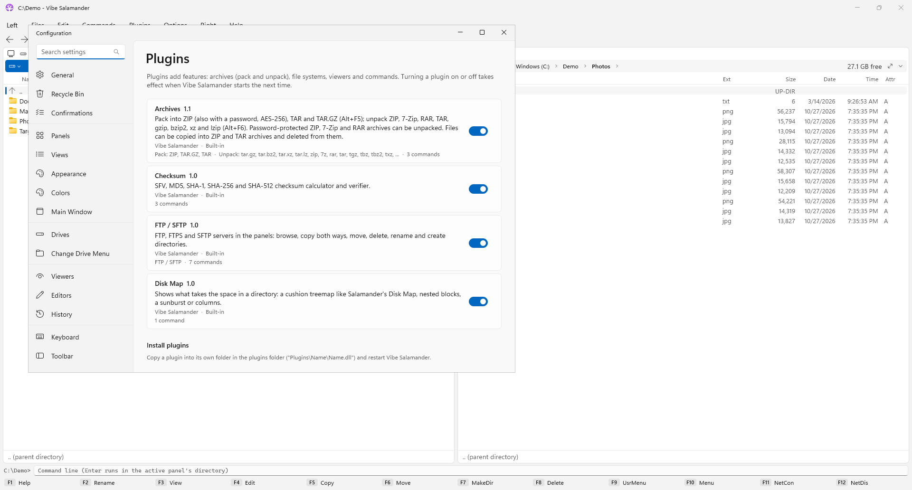
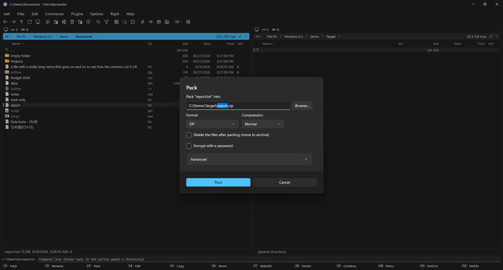
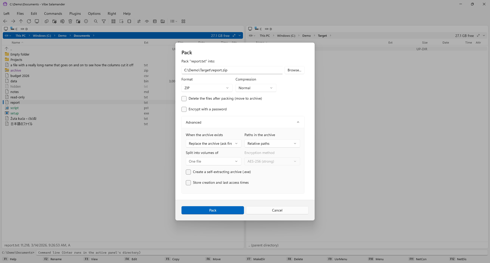
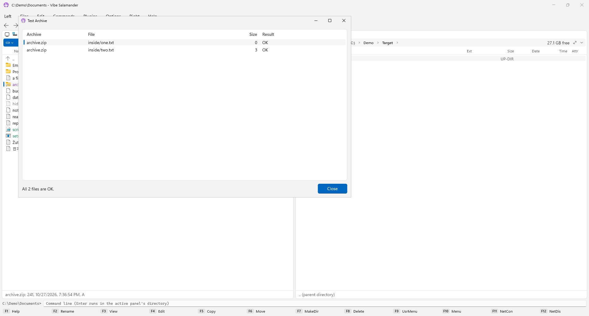
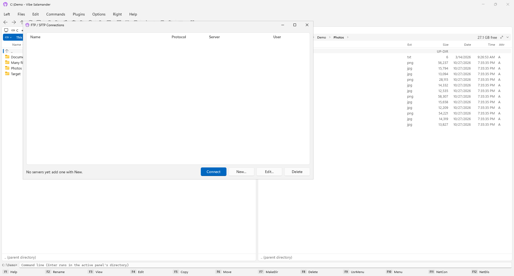
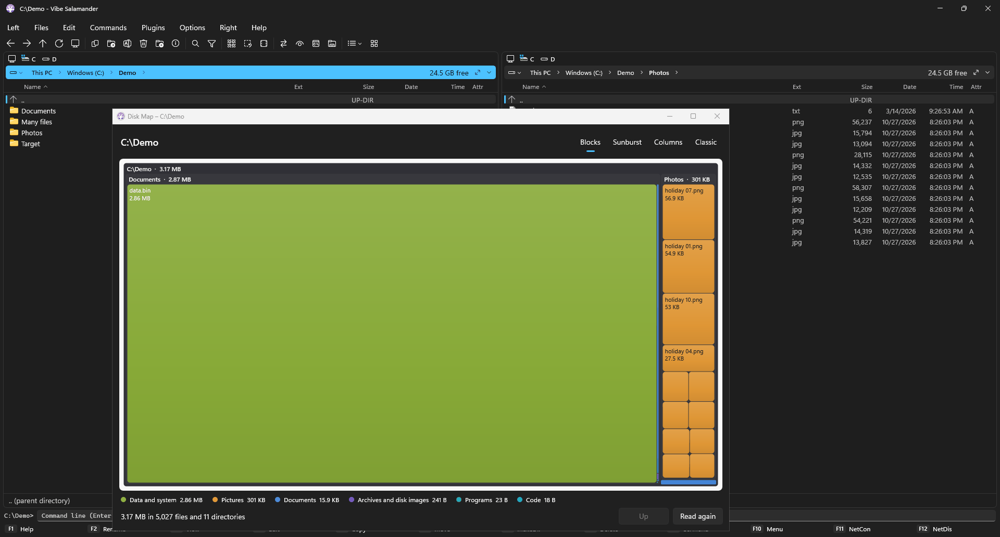
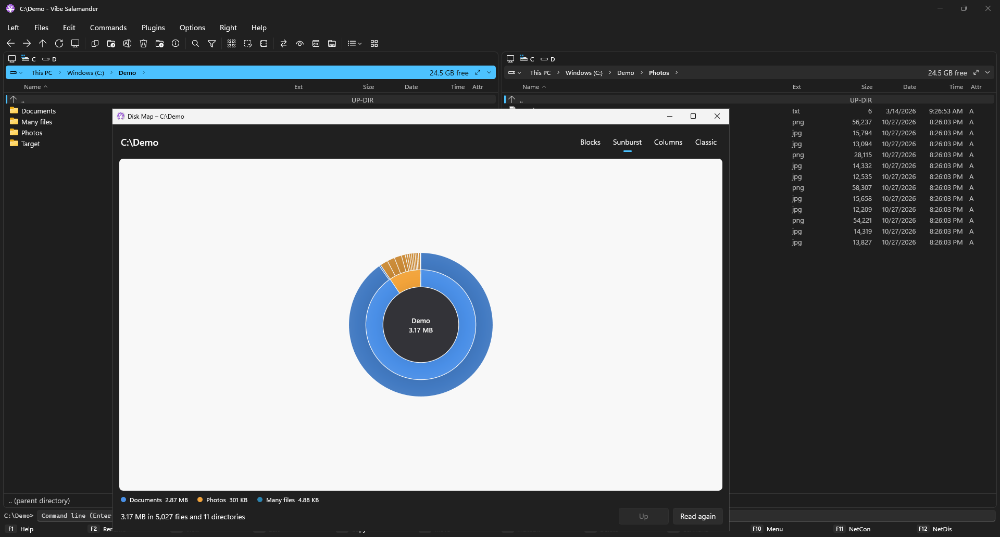
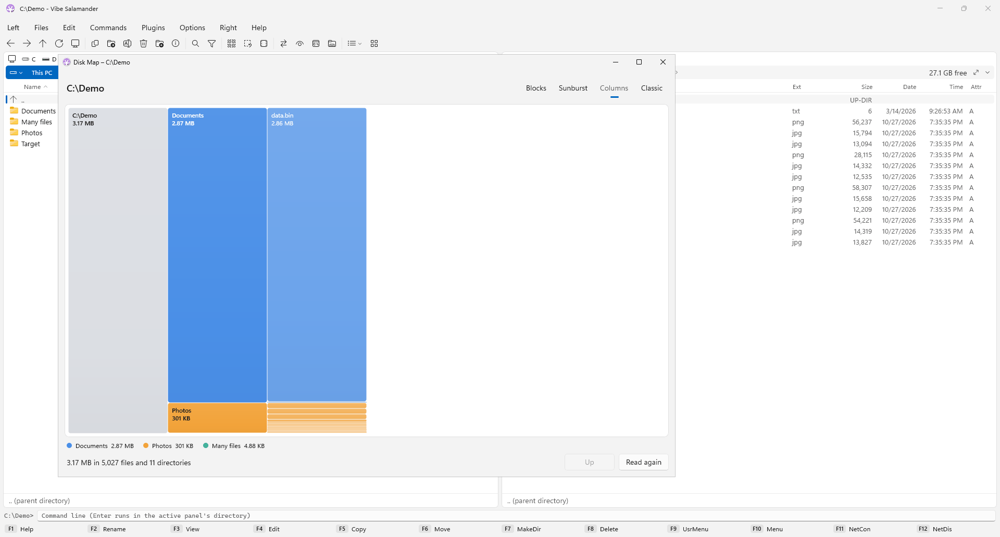
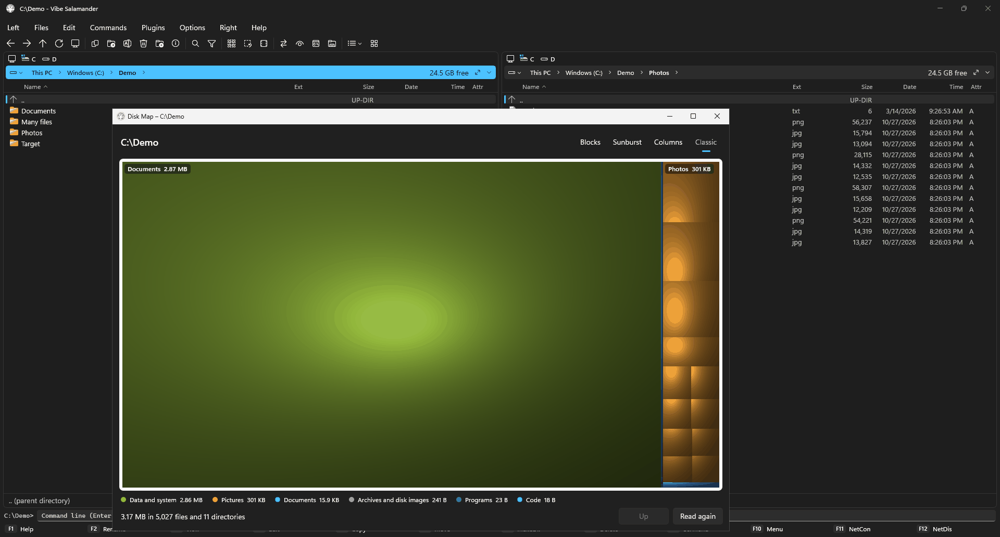

# Plugins

Plugins add archive formats, file systems and commands. **Plugins → Plugins Manager** lists them with their version and author, and turns
each on or off (the change applies when Vibe Salamander starts the next time).

Built in (they come with the program):

| Plugin | What it does |
|---|---|
| [Archives](#archives) | ZIP, TAR, TAR.GZ: pack, unpack, browse, edit, test, self-extracting archives |
| [FTP / SFTP](#ftp--sftp) | Servers in the panels like folders |
| [Checksum](#checksum) | CRC32, MD5, SHA-1, SHA-256, SHA-512: calculate and verify |
| [Disk Map](#disk-map) | What takes the space in a folder |

A separate download: [7-Zip](#7-zip). And you can [write your own](Writing-Plugins).

## Archives

- **Pack** (Alt+F5) into ZIP (optionally AES-256 encrypted), TAR or TAR.GZ. **Pack → Advanced** has update modes
  (add, update, freshen, synchronize), path modes, splitting into volumes (`.001`, `.002`…, which unpack too),
  ZipCrypto for Windows Explorer, self-extracting `.exe` and NTFS times.
- **Unpack** (Alt+F6) ZIP, 7z, RAR, TAR, gz, bz2, xz and lz, with passwords. An archive whose files are all in one
  folder says so ("Root folder x found"), and isn't put in another folder named after the archive.
- **Enter on an archive opens it like a folder**: copy single files out, and for ZIP and TAR copy or drop files
  in, delete them (F8) or move them out (F6).
- Files → **Test Archive** unpacks every file in memory and checks its CRC; **Make Self-Extracting Archive** turns
  a ZIP into an `.exe` that unpacks on any Windows 10 or 11 PC (with a title, a message, a folder and a program to
  start); **Archive Comment** for ZIPs.
- Right-click an archive: *Archives ▸* has Unpack and the commands that fit it.

| | |
|---|---|
|  |  |

## FTP / SFTP

Commands → **Connect to FTP / SFTP Server**: FTP, FTPS (explicit or implicit TLS) and SFTP, with saved servers,
passwords or SSH keys. The server opens in the panel like a folder; copies both ways run in the transfer panel.

Plugins → FTP / SFTP: Disconnect (also F12), Add bookmark, Show log, Show certificate / host key, Send command,
Show raw listing.

## Checksum

Plugins → Checksum → **Calculate Checksums** of the marked files and folders: CRC32 (saved as `.sfv`), MD5,
SHA-1, SHA-256 or SHA-512, saved into a checksum file. **Verify Checksums** (Ctrl+Shift+V) checks the files against
a checksum file again.

## Disk Map

Commands → **Disk Map** (or Plugins → Disk Map → Show disk map) shows what takes the space in the active folder.
Four views: **Blocks**, **Sunburst**, **Columns** and **Classic** (Salamander's cushion treemap). Hover for sizes,
double-click a folder to zoom in, Backspace to go back up, right-click for *Show in panel*, *Copy path* and *Read again*.

| | |
|---|---|
|  |  |
|  |  |

## 7-Zip

A separate download, because it carries 7-Zip itself (`VibeSalamander-7-Zip-plugin-<version>-win-x64.zip` on the
[releases page](https://github.com/BrainCluster/vibe-salamander/releases/latest)). Put its `7-Zip` folder into
`%AppData%\VibeSalamander\Plugins\` and restart. An installed 7-Zip works too.

- Pack 7z with all of 7-Zip's settings: method, dictionary, word size, solid blocks, threads, encrypted names,
  self-extracting archives, volumes, update modes.
- Unpack, browse, test and change 7z; unpack CAB, WIM, MSI, CHM, ARJ, LZH, RPM, DEB, DMG and more.
- Test archive, Archive information, Make self-extracting archive (Plugins → 7-Zip, or *7-Zip ▸* in an archive's
  right-click menu).

## Installing other plugins

A plugin is a folder with its DLL: `Plugins\<Name>\<Name>.dll`. Copy the folder into
`%AppData%\VibeSalamander\Plugins\` and restart Vibe Salamander.

Only install plugins you trust: a plugin is a program and can do anything Vibe Salamander can.
