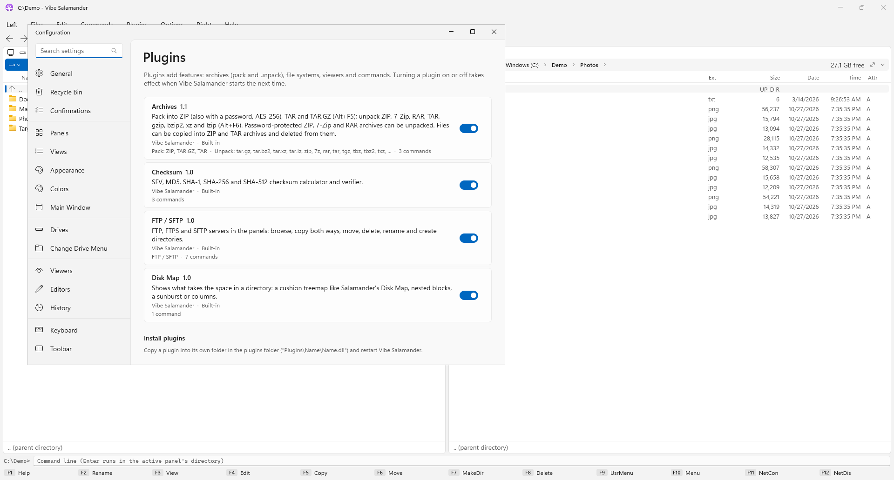
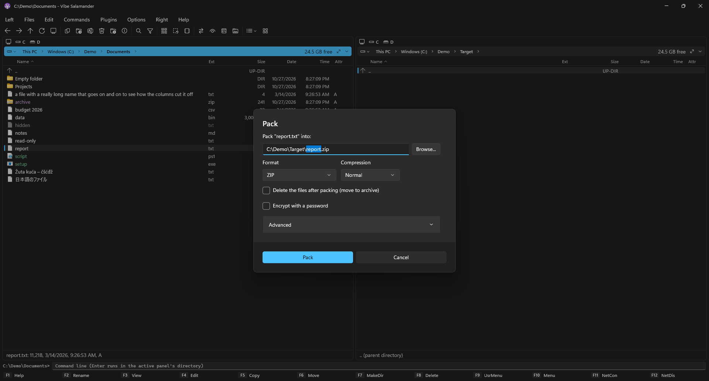
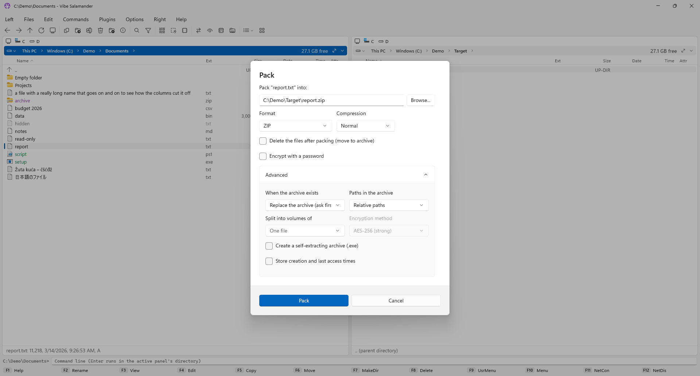
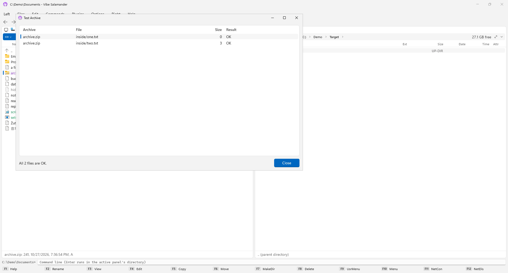
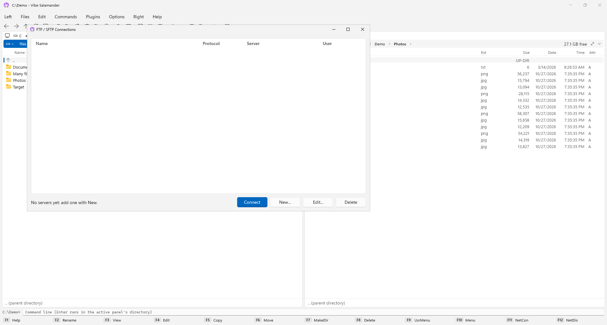
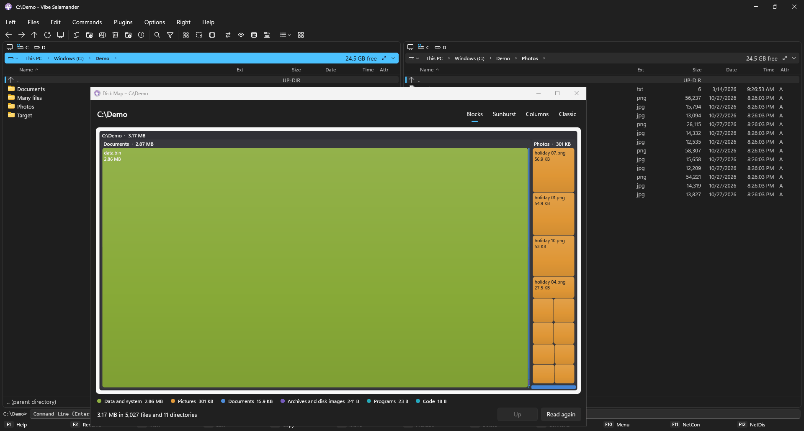
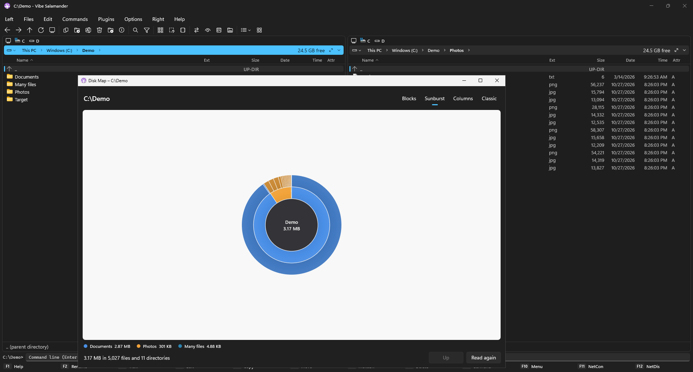
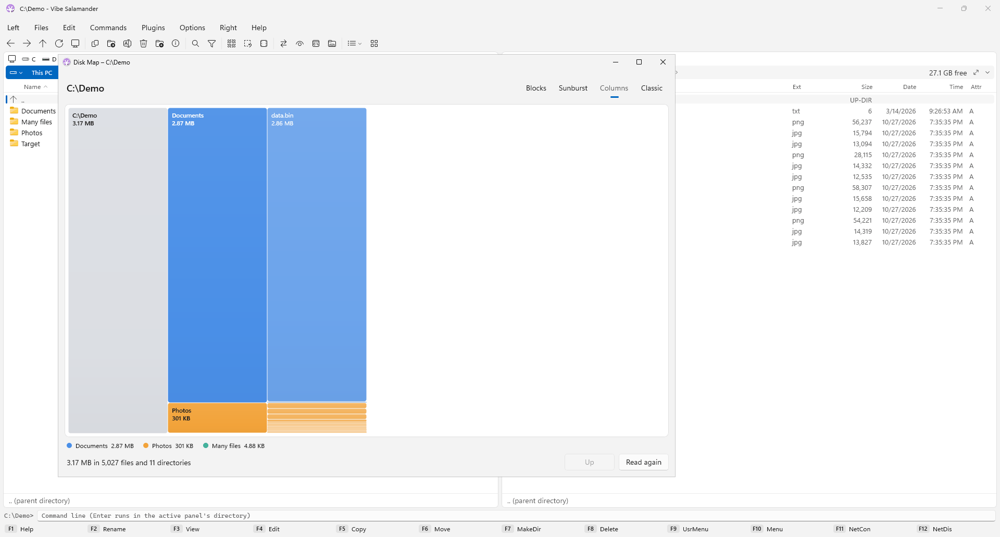
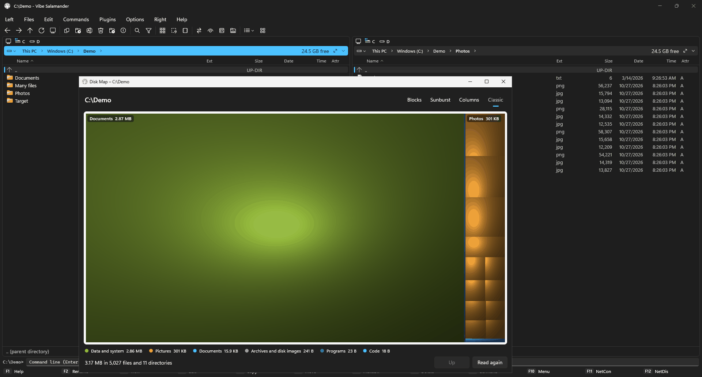

# Plugins

Plugins add archive formats, file systems and commands. **Plugins → Plugins Manager** lists them with their version and author, and turns
each on or off (the change applies when Vibe Salamander starts the next time).

Built in (they come with the program):

| Plugin | What it does |
|---|---|
| [Archives](#archives) | ZIP, TAR, TAR.GZ: pack, unpack, browse, edit, test, self-extracting archives |
| [FTP / SFTP](#ftp--sftp) | Servers in the panels like folders |
| [Checksum](#checksum) | CRC32, MD5, SHA-1, SHA-256, SHA-512: calculate and verify |
| [Disk Map](#disk-map) | What takes the space in a folder |

Separate downloads: [7-Zip](#7-zip), [Media Info](#media-info) and [Git](#git). And you can [write your own](Writing-Plugins).

## Archives

- **Pack** (Alt+F5) into ZIP (optionally AES-256 encrypted), TAR or TAR.GZ. **Pack → Advanced** has update modes
  (add, update, freshen, synchronize), path modes, splitting into volumes (`.001`, `.002`…, which unpack too),
  ZipCrypto for Windows Explorer, self-extracting `.exe` and NTFS times.
- **Unpack** (Alt+F6) ZIP, 7z, RAR, TAR, gz, bz2, xz and lz, with passwords. An archive whose files are all in one
  folder says so ("Root folder x found"), and isn't put in another folder named after the archive.
- **Enter on an archive opens it like a folder**: copy single files out, and for ZIP and TAR copy or drop files
  in, delete them (F8) or move them out (F6).
- Files → **Test Archive** unpacks every file in memory and checks its CRC; **Make Self-Extracting Archive** turns
  a ZIP into an `.exe` that unpacks on any Windows 10 or 11 PC (with a title, a message, a folder and a program to
  start); **Archive Comment** for ZIPs.
- Right-click an archive: *Archives ▸* has Unpack and the commands that fit it.

| | |
|---|---|
|  |  |

## FTP / SFTP

Commands → **Connect to FTP / SFTP Server**: FTP, FTPS (explicit or implicit TLS) and SFTP, with saved servers,
passwords or SSH keys. The server opens in the panel like a folder; copies both ways run in the transfer panel.

Plugins → FTP / SFTP: Disconnect (also F12), Add bookmark, Show log, Show certificate / host key, Send command,
Show raw listing.

## Checksum

Plugins → Checksum → **Calculate Checksums** of the marked files and folders: CRC32 (saved as `.sfv`), MD5,
SHA-1, SHA-256 or SHA-512, saved into a checksum file. **Verify Checksums** (Ctrl+Shift+V) checks the files against
a checksum file again.

## Disk Map

Commands → **Disk Map** (or Plugins → Disk Map → Show disk map) shows what takes the space in the active folder.
Four views: **Blocks**, **Sunburst**, **Columns** and **Classic** (Salamander's cushion treemap). Hover for sizes,
double-click a folder to zoom in, Backspace to go back up, right-click for *Show in panel*, *Copy path* and *Read again*.

| | |
|---|---|
|  |  |
|  |  |

## Media Info

A separate download, because it carries MediaInfo's library (`VibeSalamander-Media-Info-plugin-<version>-win-x64.zip`
or `-win-arm64.zip` on the [releases page](https://github.com/BrainCluster/vibe-salamander/releases/latest)). Put its
`Media Info` folder into `%AppData%\VibeSalamander\Plugins` (Plugins → Plugins Manager → *Open plugins folder*) and
start Vibe Salamander again.

**Media Info...** in the right-click menu of a video, audio or picture file (or Plugins → Media Info) shows what
the [MediaInfo](https://mediaarea.net/MediaInfo) app shows about the focused or marked files: the container, each
video, audio and subtitle track with its codec, profile, bit rate, resolution, frame rate, HDR, channels, sampling
rate and language, chapters and tags. It is read by MediaInfo's own library, so the details are the same.

- **Complete** shows every field MediaInfo knows, **Basic** the usual ones.
- **Copy** puts the text report on the clipboard; right-click a line to copy just its value.
- **Save Report** writes it as text, HTML, XML or JSON.
- **F3** on a video or audio file shows the text report in the viewer (pictures keep the picture viewer).

Configuration → Plugins → Media Info → **Settings...**: start in the Complete view, and turn the F3 report off.

## Git

A separate download, because it carries libgit2 (`VibeSalamander-Git-plugin-<version>-win-x64.zip` or `-win-arm64.zip`
on the [releases page](https://github.com/BrainCluster/vibe-salamander/releases/latest)). Put its `Git` folder into
`%AppData%\VibeSalamander\Plugins` and start Vibe Salamander again. Fetch, pull, push, clone and the changes need
[Git for Windows](https://git-scm.com/download/win); reading a repository doesn't.

**In the panels.** In a working tree, the path line shows the branch with the commits to push and to pull
(`main ↑2 ↓1`, or `· merging` in the middle of a merge), each file is colored by its Git state, and a **Git** column
says it: Modified, Staged, Added, Renamed, New, Conflict, Ignored, and Changes for a folder with changes inside.
They follow the repository as it changes, whether Vibe Salamander or another program changed it.

**Right-click a repository's folder** for *Git ▸* Changes..., History..., Fetch, Pull and Push on that repository
(handy in a folder of projects), or inside it the empty area or `..` of its top folder (not of its subfolders); a file in a repository has *Git ▸* History of This File and Blame. The Plugins → Git
menu works on the focused repository folder too, else on the repository the panel is in.

**Changes** (Plugins → Git → Changes...): the staged and unstaged changes, new files and conflicts.

- **Stage**, **Unstage** and **Stage All**; **Discard...** puts a file back to its staged (or last committed)
  version, and sends a new file to the Recycle Bin.
- **Compare** (or Enter) shows the change in the file comparator: the working tree against the staged version, or
  the staged version against the last commit.
- **Commit...** asks for the message, with *Amend the last commit*. With nothing staged, it offers to stage all.

**History** (Plugins → Git → History..., or *Git History of This File...* in a file's right-click menu): the commits
with a graph of the branches and merges, their branches and tags, author, date and ID.

- **Changed Files...** lists what a commit changed; Compare shows a file against its version before the commit.
- **Browse This Version** opens the commit's whole tree in the panel: look around, view files with F3, and copy
  files or folders out with F5. It is read-only; Up from its top goes back to the repository's folder.
- **Git Blame...** (in a file's right-click menu, or Plugins → Git) shows who last changed each line, in which
  commit and when.

**Fetch, Pull, Push, Clone...** (Plugins → Git) run as jobs in the transfer panel, with Git's progress, and can be
cancelled there; a failure shows Git's own message. Push sends a branch with no upstream to `origin` and sets it as
the upstream. Clone asks for the address, the folder (by default the one in the settings, else the active panel's)
and the new folder's name.

**Safety.** Repositories are read inside Vibe Salamander (by libgit2), so looking at a repository never runs its
hooks or any program. What changes a repository or talks to a server runs in your own Git, started by its full
path: the one set in Configuration → Plugins → Git → **Settings...**, else the first `git.exe` on the PATH (relative
PATH entries are skipped), else Git for Windows' usual folder — never a `git.exe` from the repository's folder.
Git's password prompts go to Git's credential manager; there is no console to wait on.

## 7-Zip

A separate download, because it carries 7-Zip itself (`VibeSalamander-7-Zip-plugin-<version>-win-x64.zip` on the
[releases page](https://github.com/BrainCluster/vibe-salamander/releases/latest)). Put its `7-Zip` folder into
`%AppData%\VibeSalamander\Plugins\` and restart. An installed 7-Zip works too.

- Pack 7z with all of 7-Zip's settings: method, dictionary, word size, solid blocks, threads, encrypted names,
  self-extracting archives, volumes, update modes.
- Unpack, browse, test and change 7z; unpack CAB, WIM, MSI, CHM, ARJ, LZH, RPM, DEB, DMG and more.
- Test archive, Archive information, Make self-extracting archive (Plugins → 7-Zip, or *7-Zip ▸* in an archive's
  right-click menu).

## Installing other plugins

A plugin is a folder with its DLL: `Plugins\<Name>\<Name>.dll`. Copy the folder into
`%AppData%\VibeSalamander\Plugins\` and restart Vibe Salamander.

Only install plugins you trust: a plugin is a program and can do anything Vibe Salamander can.
