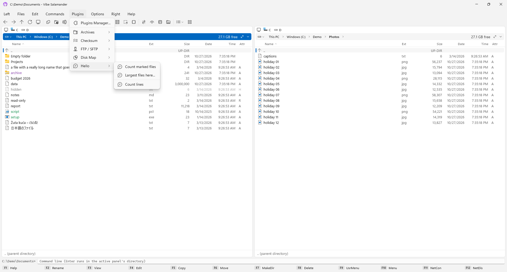
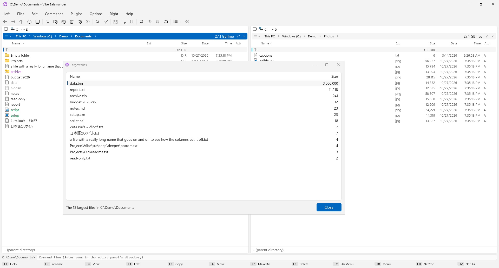

# Writing plugins

A plugin is a .NET class library (C#) with a class that implements `IVibePlugin`. Through the host it gets, it
can add **commands** to the Plugins menu and to right-click menus, open **windows** (lists, pictures, forms,
questions), add **archive formats** to Pack and Unpack, and show **file systems** (like FTP) in the panels.

The quickest way in is the example plugin in the repository,
[`samples/HelloPlugin`](https://github.com/BrainCluster/vibe-salamander/tree/main/samples/HelloPlugin): one file,
three commands. It is built on every push, so it always matches the current plugin API.



## 1. The project

You need the [.NET 10 SDK](https://dotnet.microsoft.com/download) (or Visual Studio 2026). Make a class library
and reference the two DLLs from Vibe Salamander's `lib` folder, with `Private` set to false: the app shares its
own copies with every plugin, so they must not be copied next to yours.

```xml
<Project Sdk="Microsoft.NET.Sdk">
  <PropertyGroup>
    <TargetFramework>net10.0-windows10.0.22621.0</TargetFramework>
    <TargetPlatformMinVersion>10.0.19041.0</TargetPlatformMinVersion>
    <Nullable>enable</Nullable>
    <ImplicitUsings>enable</ImplicitUsings>
  </PropertyGroup>
  <ItemGroup>
    <Reference Include="VibeSalamander.Plugins.Abstractions">
      <HintPath>C:\Tools\VibeSalamander\lib\VibeSalamander.Plugins.Abstractions.dll</HintPath>
      <Private>false</Private>
    </Reference>
    <Reference Include="VibeSalamander.Core">
      <HintPath>C:\Tools\VibeSalamander\lib\VibeSalamander.Core.dll</HintPath>
      <Private>false</Private>
    </Reference>
  </ItemGroup>
</Project>
```

(Change `C:\Tools\VibeSalamander` to where you unzipped Vibe Salamander. Inside a clone of the repository you can
reference `src\VibeSalamander.Plugins.Abstractions\VibeSalamander.Plugins.Abstractions.csproj` instead, as the
sample does.)

## 2. The plugin class

```csharp
using VibeSalamander.Core.FileSystem;
using VibeSalamander.Plugins;

public sealed class HelloPlugin : IVibePlugin, ICommandContributor
{
    public string Id => "example.hello";          // unique; also names its data folder
    public string DisplayName => "Hello";         // the submenu in Plugins
    public Version Version => new(1, 0);
    public string Description => "An example plugin.";
    public string Author => "Your name";
    public string? IconGlyph => "\uE8BD";         // a Segoe Fluent Icons character

    public IReadOnlyList<PluginCommand> Commands { get; private set; } = Array.Empty<PluginCommand>();

    public void Initialize(IPluginHost host)
    {
        Commands = new[]
        {
            new PluginCommand("count", "Count marked files", null, CountMarked),
        };
        host.RegisterCommands(this);
    }

    public void Shutdown() { }

    private static Task CountMarked(IPluginHost host)
    {
        int n = host.ActivePanel.MarkedItems.Count;
        host.Notify($"{n} items marked in {host.ActivePanel.Path}");   // a notification, no dialog
        return Task.CompletedTask;
    }
}
```

`Initialize` runs once when Vibe Salamander starts; register everything there. `Shutdown` runs when it exits.

## 3. Install and try it

1. `dotnet build -c Release`
2. Copy `bin\Release\…\HelloPlugin.dll` into **`%AppData%\VibeSalamander\Plugins\HelloPlugin\`** (the folder and
   the DLL share the name; other DLLs your plugin needs go next to it).
3. Restart Vibe Salamander. Your commands are in **Plugins → Hello**, and the plugin is listed in the
   Plugins Manager. If it failed to load, the Plugins Manager shows why, and so does the error log
   (Help → Error Log).

Each plugin loads in its own `AssemblyLoadContext`, so its dependencies can't clash with the app's or another
plugin's.

## What a plugin can use

### The host (`IPluginHost`)

| Member | |
|---|---|
| `ActivePanel`, `InactivePanel` | `Path`, `FocusedItem`, `MarkedItems`, `NavigateAsync(path, focusName)`, `RefreshAsync()` |
| `Notify(message, isError)` | A short message in the notification bar |
| `Ui` | Windows and dialogs (below) |
| `RegisterCommands(contributor)` | Commands in Plugins → *your plugin* |
| `RegisterArchiver(archiver)` | Formats for Pack (Alt+F5), Unpack (Alt+F6) and browsing archives |
| `RegisterFileSystem(fileSystem)` | A file system in the panels, with paths like `sftp://user@host/dir` |
| `GetDataDirectory(plugin)` | A folder for the plugin's settings and data |
| `HostVersion` | The version of Vibe Salamander |

### Commands (`PluginCommand`)

```csharp
new PluginCommand(
    Id: "lines",
    MenuText: "Count lines",
    ShortcutText: null,                  // shown in the menu only; keys are set in Configuration → Keyboard
    Execute: CountLines,                 // Func<IPluginHost, Task>, runs on the UI thread
    AppliesTo: path => path.EndsWith(".txt", StringComparison.OrdinalIgnoreCase),
    SeparatorBefore: true)
```

With `AppliesTo`, the command also appears in the right-click menu of the files it fits, under the plugin's name.
`Execute` runs on the UI thread: put long work into `Task.Run` and await it.

### Windows and dialogs (`host.Ui`)

They can be called from any thread; the host moves the work to the UI thread. A plugin never touches WinUI itself.
The dialogs take an optional `owner` (one of the plugin's list windows) to show in.

| Method | |
|---|---|
| `OpenListWindow(title, columns)` | A window with rows and columns, a status line, a progress bar, buttons, a log and a right-click menu for rows (the Checksum and Test archive windows) |
| `OpenCanvasWindow(title)` | A window with a picture the plugin draws (pixels), labels, views and a legend (the Disk Map) |
| `ConfirmAsync`, `ShowMessageAsync` | A Yes / No question, a message |
| `EditOptionsAsync(title, description, options)` | Check boxes |
| `EditFieldsAsync(title, description, fields, validate)` | A form: text, password, choice, check box, file and multi-line fields |
| `AskSaveFileAsync(title, suggestedPath, types, selectedType)` | Where to save a file and in which format |
| `CopyToClipboard(text)` | |
| `T(english)` | The text in the user's language, when the app's translations have it |

The example's *Largest files here…* command fills a list window:

```csharp
IPluginListWindow window = host.Ui.OpenListWindow("Largest files", new[]
{
    new PluginColumn("Name", 0),                       // 0 = takes the remaining width
    new PluginColumn("Size", 140, AlignRight: true),
});
window.SetButtons(new[] { new PluginButton("close", "Close", window.Close, IsDefault: true) });
window.SetProgress(-1);                                 // busy
var files = await Task.Run(() => /* find the files */);
foreach (var f in files)
    window.AddRow(new[] { f.Name, f.Length.ToString("N0") });
window.SetProgress(null);                               // hide the progress bar
window.SetStatus($"The {files.Count} largest files");
window.RowMenu = row => new[] { new PluginMenuItem("Copy name", null, () => host.Ui.CopyToClipboard(row[0])) };
```



### Archive formats (`IArchiver`)

Implement `IArchiver` and register it with `host.RegisterArchiver`. It says which formats it can create
(`PackFormats`, shown in Alt+F5) and which file endings it unpacks, lists an archive's items (so Enter browses
it like a folder), and packs, unpacks, adds and deletes. The long operations get an `IArchiveJob`: report
progress with a `ProgressTracker`, call `WaitWhilePaused()` often, stop when `Cancellation` is cancelled, and ask
about existing files, errors and passwords through it. They run in the transfer panel like copies do.

The built-in [Archive plugin](https://github.com/BrainCluster/vibe-salamander/tree/main/src/VibeSalamander.Plugins.Archive)
and the [7-Zip plugin](https://github.com/BrainCluster/vibe-salamander/tree/main/src/VibeSalamander.Plugins.SevenZip)
are complete examples.

### File systems (`IPluginFileSystem`)

A file system owns paths of its own (`ftp://…`, `sftp://…`): it lists a directory, gives the parent of a path,
copies to and from local folders, deletes, renames and creates directories. The panels show it like a disk;
copies run in the transfer panel. See the
[FTP / SFTP plugin](https://github.com/BrainCluster/vibe-salamander/tree/main/src/VibeSalamander.Plugins.Ftp).

## The full API

Everything is in one file with a comment on each member:
[`src/VibeSalamander.Plugins.Abstractions/Contracts.cs`](https://github.com/BrainCluster/vibe-salamander/blob/main/src/VibeSalamander.Plugins.Abstractions/Contracts.cs).
The built-in plugins in `src/VibeSalamander.Plugins.*` use nothing else.

The API is young and may still change between versions (`host.HostVersion` tells you which one you run in).
Questions and ideas: [open an issue](https://github.com/BrainCluster/vibe-salamander/issues/new/choose).

## Sharing your plugin

Zip the plugin's folder (`HelloPlugin\HelloPlugin.dll` and whatever it needs). Vibe Salamander is GPL-3.0; a plugin
that links to its DLLs is generally considered a derivative work, so publish your plugin's source under a
GPL-compatible license.
